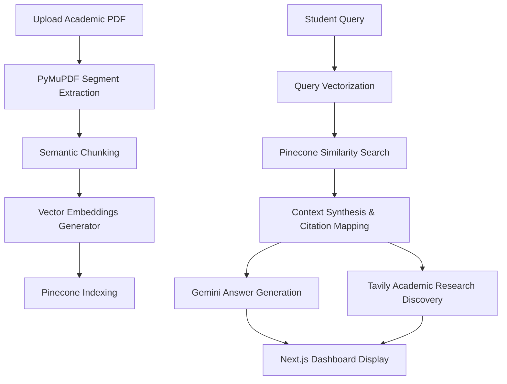

# 🔬 Alethia.ai: AI Academic Explainer & RAG Research Assistant

[](https://nextjs.org/)
[](https://fastapi.tiangolo.com/)
[](https://ai.google.dev/)
[](https://www.pinecone.io/)
[](https://www.typescriptlang.org/)
[](https://tailwindcss.com/)
[](https://opensource.org/licenses/MIT)

**Alethia.ai** (named after the Greek concept *Aletheia* meaning "unconcealment" or "truth") is a state-of-the-art, AI-powered academic literature review and document explanation platform. It leverages retrieval-augmented generation (RAG), vector similarity search, and advanced natural language models to parse complex scientific papers, highlight direct source citations, and discover related literature in real time.

---

## 🚀 Key Features

### 📄 Intelligent PDF Processing & RAG
- **Advanced Text Extraction**: Seamlessly parses multi-page PDFs using PyMuPDF.
- **Exact Source Highlighting**: Automatically maps AI claims directly to the exact page and source segment, complete with interactive highlight badges in the PDF viewer.
- **Semantic Vector Storage**: Indexes document chunks into a Pinecone vector database using lightweight, optimized sentence embeddings.

### 🧠 Multilingual & Global Exploration
- **Multilingual Support**: Supports 100+ global and regional languages with automatic script and dialect detection.
- **Gemini 2.5 Flash Integration**: Powered by Gemini's long-context capabilities for deep comprehension and cross-language synthesis.
- **Hugging Face Compatibility**: Configured to switch between local embedding models (e.g., `all-MiniLM-L6-v2`) depending on performance requirements.

### 🔬 Deep Research Mode
- **Tavily Web Search**: Discovers related research papers, direct links, match percentages, and academic abstracts automatically based on your query context.
- **Context-Aware Memory**: Retains conversation history to allow continuous exploration of complex academic fields.

---

## 🏗️ System Architecture



---

## 🛠️ Technology Stack

| Layer | Component | Technology | Purpose |
| :--- | :--- | :--- | :--- |
| **Frontend** | Next.js 14, TypeScript, React 18 | Web Application UI | Sleek, dark-themed responsive student dashboard |
| **Styling** | Tailwind CSS, Framer Motion | Animations & Style | Premium glassmorphism and typing effects |
| **Backend** | FastAPI, Python 3.10 | Core API | Text processing, RAG orchestration, and endpoints |
| **Vector DB** | Pinecone | Database | Sub-millisecond similarity search |
| **Embeddings** | Hugging Face Transformers | Vector Extraction | Light sentence representation model (`all-MiniLM-L6-v2`) |
| **LLM Engine** | Gemini 2.5 via OpenRouter | Intelligence | Model synthesis, explanations, and summarization |
| **Web Research** | Tavily API | Real-time Search | Peer-reviewed academic paper discovery |

---

## ⚙️ Quick Start Setup

### Prerequisites
- Python 3.9+ installed
- Node.js 18+ installed
- A Pinecone account and API key
- An OpenRouter API key (or direct Google Gemini key)
- A Tavily API key

---

### 1. Backend Setup (FastAPI)

1. Navigate to the root directory and create a virtual environment:
   ```bash
   python -m venv venv
   source venv/bin/activate  # On Windows use: venv\Scripts\activate
   ```

2. Install backend dependencies:
   ```bash
   pip install -r requirements.txt
   ```

3. Configure your root `.env` file (copied from `.env.example`):
   ```ini
   OPENROUTER_API_KEY=your_key_here
   PINECONE_API_KEY=your_key_here
   PINECONE_REGION=us-east-1
   TAVILY_API_KEY=your_key_here
   EMBEDDING_MODEL=all-MiniLM-L6-v2
   ```

4. Run the FastAPI development server:
   ```bash
   python server.py
   ```
   The backend will start on `http://127.0.0.1:8000`.

---

### 2. Frontend Setup (Next.js)

1. Navigate to the frontend directory:
   ```bash
   cd frontend
   ```

2. Install node dependencies:
   ```bash
   npm install
   ```

3. Configure your local frontend env file `frontend/.env.local`:
   ```ini
   NEXT_PUBLIC_BACKEND_URL=http://127.0.0.1:8000
   ```

4. Launch the Next.js development server:
   ```bash
   npm run dev
   ```
   Open your browser and navigate to `http://localhost:3000` to launch the platform.

---

## 🐳 Docker Deployment

The backend is fully dockerized with a CPU-optimized PyTorch build to keep the memory footprint under 512MB RAM, making it perfect for free tiers like Render, Railway, or Hugging Face.

To build and run the backend container locally:
```bash
docker build -t alethia-backend .
docker run -p 8000:8000 --env-file .env alethia-backend
```

---

## 📄 License
This project is licensed under the MIT License - see the [LICENSE](LICENSE) file for details.

---

<div align="center">
  <p>Made with ❤️ for academic discovery and truth.</p>
</div>